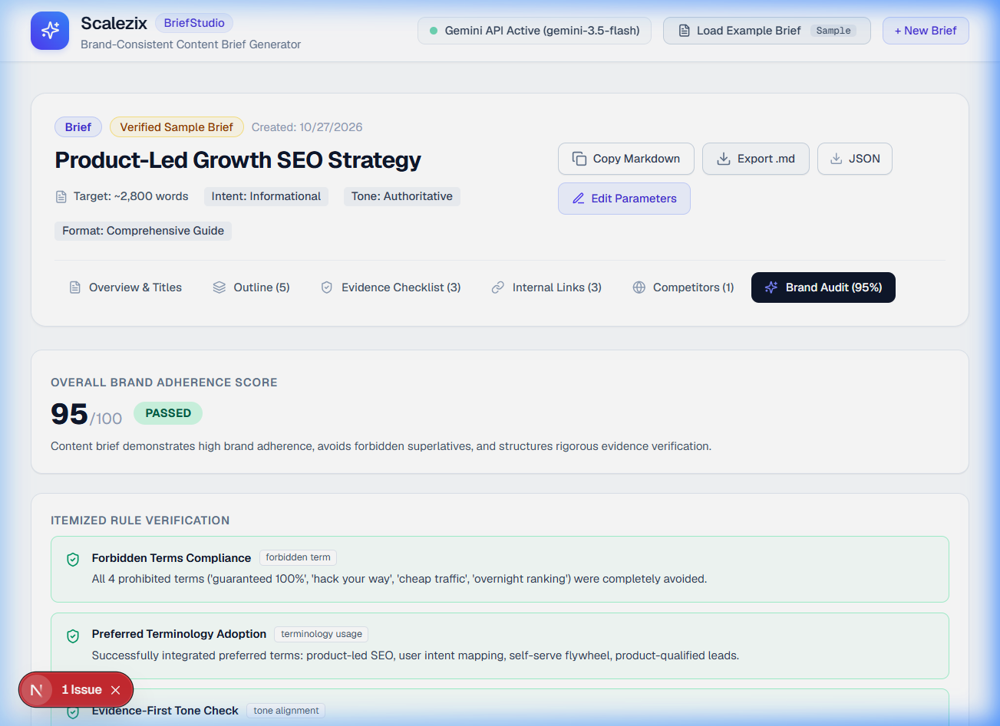
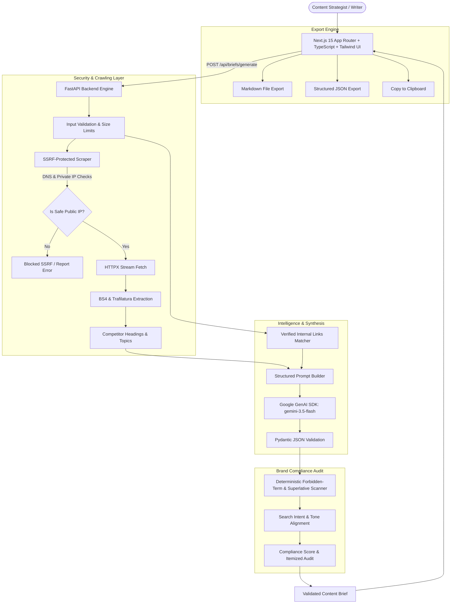

# Brand-Consistent Content Brief Generator

> **Scalezix Internship Assessment — Project #4**  
> An AI-powered SaaS application that creates actionable, evidence-backed, and brand-consistent content briefs without inventing facts, statistics, competitor findings, or internal URLs.

[](https://nextjs.org/)
[](https://fastapi.tiangolo.com/)
[](https://ai.google.dev/)
[](https://tailwindcss.com/)
[](#)

---

## 1. Project Purpose & Overview

Content writers often struggle to structure comprehensive, search-optimized articles without falling into the trap of superficial AI regurgitation or fabricated citations. Traditional generative AI workflows frequently hallucinate statistics, attribute claims to nonexistent studies, and invent company URLs.

The **Brand-Consistent Content Brief Generator** solves this problem by enforcing **strict evidence verification guardrails**:
1. **Never Invent Facts or Statistics**: Any factual claim or benchmark needed in the brief is explicitly flagged in an **Evidence & Fact Verification Checklist** with instructions for human researchers to cite primary sources.
2. **Never Invent Internal URLs**: Internal linking recommendations are strictly drawn from a user-supplied repository of verified company URLs. Non-existent pages or guessed paths are blocked.
3. **Truthful Competitor Analysis**: Real competitor pages are crawled via an SSRF-protected extraction service (extracting actual `H1`, `H2`, `H3` headings, word counts, and topics). If a competitor page is inaccessible or blocked, it is truthfully marked as failed rather than fabricated.
4. **Deterministic Brand Guideline Audit**: Outline headings, titles, and talking points are audited by a hybrid rule engine that scans for prohibited terms, unverified marketing superlatives, search intent alignment, and preferred terminology adoption.

---

## 2. Visual Walkthrough & Screenshots

| Input Parameters & Form View | Interactive Brief Workspace |
| :---: | :---: |
|  |  |

---

## 3. System Architecture



---

## 4. Key Features

- **Multi-Angle Title Generation**: Generates 4 distinct editorial angles (How-To, Data-Driven, Thought Leadership, Comparative) with character counts and strategic rationales.
- **Hierarchical Outline Builder**: Complete H2/H3 structure with section purposes, target word count allocations, talking points, questions answered, and evidence requirements.
- **Evidence & Fact Verification Checklist**: Identifies claims and statistics requiring trustworthy sources. Clearly marked with **"Human Check Required"** badges to prevent fabricated research.
- **SSRF-Protected Competitor Scraper**: Validates URLs, blocks loopback/private/link-local/cloud metadata IPs (`169.254.169.254`), re-validates redirects, and extracts headings without hallucinations.
- **Anti-Hallucination Internal Linking**: Restricts link suggestions to verified company URLs provided in the request.
- **Brand Compliance Audit**: Evaluates brief adherence to tone, search intent, preferred terms, and prohibited words, returning a 0–100 compliance score.
- **Interactive In-Place Editing**: Edit suggested H1s, section headings, and target word counts directly in the UI.
- **Flexible Export**: One-click **Copy Markdown**, **Download `.md`**, and **Download `.json`**.
- **One-Click Verified Sample Brief**: Instant evaluator testing with pre-packaged B2B SaaS scenario (*"Product-Led Growth SEO Strategy"*).

---

## 5. Technology Stack

### Frontend
- **Framework**: Next.js 15 (App Router)
- **Language**: TypeScript
- **Styling**: Tailwind CSS v4
- **Icons**: Lucide React
- **HTTP Client**: Native Fetch with typed error wrappers

### Backend
- **Framework**: FastAPI (Python 3.14 / 3.11+)
- **Validation**: Pydantic v2 & Pydantic Settings
- **HTTP Client**: HTTPX (async, SSRF-guarded)
- **HTML Parsing**: BeautifulSoup4 & Trafilatura
- **AI SDK**: Official `google-genai` Python SDK
- **Testing**: Pytest & Pytest-Asyncio

---

## 6. Directory Structure

```text
scalezix-content-brief/
├── backend/
│   ├── app/
│   │   ├── models/
│   │   │   └── brief.py          # Pydantic data schemas
│   │   ├── routes/
│   │   │   └── briefs.py         # API endpoints (/generate, /sample, /export, /audit)
│   │   ├── services/
│   │   │   ├── scraper.py        # SSRF-protected competitor fetcher
│   │   │   ├── gemini_service.py # Google GenAI SDK integration
│   │   │   ├── brand_audit.py    # Deterministic brand compliance engine
│   │   │   ├── export_service.py # Markdown & JSON formatting
│   │   │   └── sample_brief.py   # Curated production sample data
│   │   ├── config.py             # Settings loader via pydantic-settings
│   │   └── main.py               # FastAPI entrypoint with CORS & error handlers
│   ├── tests/
│   │   ├── test_scraper.py       # SSRF protection and URL validation tests
│   │   ├── test_brand_audit.py   # Brand compliance and forbidden word tests
│   │   └── test_briefs.py        # API endpoint tests with mocked Gemini AI
│   ├── .env.example
│   └── requirements.txt
├── frontend/
│   ├── src/
│   │   ├── app/
│   │   │   ├── globals.css       # Tailwind CSS v4 styling
│   │   │   ├── layout.tsx        # App layout and metadata
│   │   │   └── page.tsx          # Main workspace page
│   │   ├── components/
│   │   │   ├── Header.tsx        # Top navigation with live backend health badge
│   │   │   ├── BriefForm.tsx     # Comprehensive brief parameters form
│   │   │   ├── BriefView.tsx     # Interactive editable brief workspace
│   │   │   └── LoadingOverlay.tsx# Multi-step progress indicator
│   │   ├── lib/
│   │   │   ├── api.ts            # Typed backend API client
│   │   │   └── utils.ts          # Class merging helper
│   │   └── types/
│   │       └── brief.ts          # TypeScript interfaces
│   ├── .env.example
│   ├── package.json
│   └── tsconfig.json
├── sample_reports/
│   ├── sample_content_brief_product_led_growth_seo.md
│   └── sample_content_brief_product_led_growth_seo.json
├── screenshots/
│   ├── app_form_view.png
│   └── app_brief_workspace.png
├── README.md
└── .gitignore
```

---

## 7. Environment Variables

### Backend (`backend/.env`)
| Variable | Description | Example Value |
| :--- | :--- | :--- |
| `GEMINI_API_KEY` | Google Gemini API key | `your_gemini_api_key_here` |
| `GEMINI_MODEL` | Active Gemini model ID | `gemini-3.5-flash` |
| `ALLOWED_ORIGINS` | Comma-separated allowed CORS origins | `http://localhost:3000,http://127.0.0.1:3000` |
| `PORT` | Backend port | `8000` |
| `HOST` | Backend host | `0.0.0.0` |

### Frontend (`frontend/.env.local`)
| Variable | Description | Example Value |
| :--- | :--- | :--- |
| `NEXT_PUBLIC_BACKEND_URL` | Base URL of FastAPI backend | `http://localhost:8000` |

---

## 8. Local Setup & Execution Guide

### Prerequisites
- Python 3.11+ (Python 3.14 verified)
- Node.js 18+ (Node.js v24 verified)
- npm 9+

### Backend Setup
1. Open terminal and navigate to backend directory:
   ```bash
   cd backend
   ```
2. Create and activate a Python virtual environment:
   ```bash
   python -m venv venv
   # On Windows:
   .\venv\Scripts\activate
   # On macOS/Linux:
   source venv/bin/activate
   ```
3. Install dependencies:
   ```bash
   pip install -r requirements.txt
   ```
4. Configure environment variables:
   ```bash
   cp .env.example .env
   # Ensure GEMINI_API_KEY is populated with your Google AI Studio key
   ```
5. Run the FastAPI development server:
   ```bash
   python -m uvicorn app.main:app --host 127.0.0.1 --port 8000 --reload
   ```
   Backend will be running at `http://127.0.0.1:8000` (Docs: `http://127.0.0.1:8000/docs`).

### Frontend Setup
1. Open a new terminal and navigate to frontend directory:
   ```bash
   cd frontend
   ```
2. Install dependencies:
   ```bash
   npm install
   ```
3. Configure environment variables:
   ```bash
   cp .env.example .env.local
   ```
4. Start the Next.js development server:
   ```bash
   npm run dev -- --port 3000
   ```
5. Open your browser and navigate to `http://localhost:3000`.

---

## 9. Automated Testing Guide

Run the comprehensive pytest suite covering SSRF protection, brand audit rules, input validation, export formatting, and mocked AI generation:

```bash
# From the project root:
$env:PYTHONPATH="backend"
.\backend\venv\Scripts\pytest -v backend/tests
```

### Test Suite Results:
- `test_brand_audit_detects_forbidden_words`: **PASSED**
- `test_brand_audit_passes_compliant_brief`: **PASSED**
- `test_health_check_endpoint`: **PASSED**
- `test_sample_brief_endpoint`: **PASSED**
- `test_export_endpoint_markdown_and_json`: **PASSED**
- `test_validation_rejects_empty_keyword`: **PASSED**
- `test_generate_brief_with_mocked_ai`: **PASSED**
- `test_safe_url_validation (SSRF Filter)`: **PASSED**

---

## 10. API Endpoints

| Method | Endpoint | Description |
| :--- | :--- | :--- |
| `GET` | `/health` | Health check returning service status and active Gemini model. |
| `POST` | `/api/briefs/generate` | Generates a structured brief from keyword, audience, tone, competitor URLs, and brand rules. |
| `GET` | `/api/briefs/sample` | Returns a curated production-grade example brief for instant evaluation. |
| `POST` | `/api/briefs/export` | Formats a brief into Markdown or JSON file payloads. |
| `POST` | `/api/briefs/audit` | Re-evaluates an edited brief against brand guidelines and forbidden claims. |

---

## 11. Deployment Guide

### Deploy Backend to Render
1. Push this repository to GitHub.
2. In [Render Dashboard](https://dashboard.render.com/), click **New +** > **Web Service**.
3. Select your repository.
4. Configure service settings:
   - **Name**: `scalezix-content-brief-api`
   - **Root Directory**: `backend`
   - **Environment**: `Python 3`
   - **Build Command**: `pip install -r requirements.txt`
   - **Start Command**: `uvicorn app.main:app --host 0.0.0.0 --port $PORT`
5. Add Environment Variables:
   - `GEMINI_API_KEY`: `<Your Google Gemini API Key>`
   - `GEMINI_MODEL`: `gemini-3.5-flash`
   - `ALLOWED_ORIGINS`: `https://your-frontend.vercel.app`
6. Click **Create Web Service**. Note the deployed URL (e.g. `https://scalezix-content-brief-api.onrender.com`).

### Deploy Frontend to Vercel
1. In [Vercel Dashboard](https://vercel.com/), click **Add New...** > **Project**.
2. Import your GitHub repository.
3. Configure project settings:
   - **Framework Preset**: `Next.js`
   - **Root Directory**: `frontend`
4. Add Environment Variables:
   - `NEXT_PUBLIC_BACKEND_URL`: `https://scalezix-content-brief-api.onrender.com` (your Render backend URL)
5. Click **Deploy**.

---

## 12. Assessment Verification Checklist

- [x] Form with target keyword, audience, search intent, content type, tone, brand guidelines, preferred terms, forbidden claims, competitor URLs, and verified internal links.
- [x] Structured titles with angles and character count compliance.
- [x] Suggested H1 and structured H2/H3 outline with dedicated section purposes, target word counts, talking points, questions answered, and evidence requirements.
- [x] Evidence checklist identifying facts requiring trustworthy sources with **Human Check Required** badges.
- [x] SSRF-protected competitor scraping extracting real headings without fabricating unavailable pages.
- [x] Verified internal linking strictly restricted to user-supplied URLs.
- [x] Deterministic brand guideline audit with compliance scoring and violation detection.
- [x] Interactive editable brief workspace with Markdown and JSON export.
- [x] Responsive, accessible SaaS interface using Next.js 15, Tailwind CSS, and Lucide React.
- [x] Automated tests with mocked AI calls passing 100%.
- [x] Live Gemini API verified via official `google-genai` SDK.
